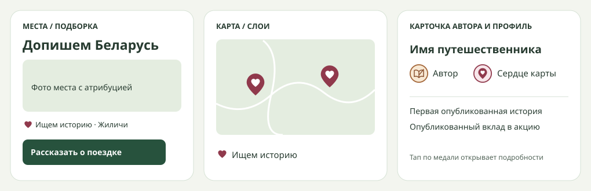

# «Допишем Беларусь вместе»

Согласуемые состояния веб-пилота и двух авторских медалей. Основной поток — открытое приглашение, короткая заметка с выбранной точкой, модерация и появление истории на обычной карте. На телефоне показывается одна колонка, на планшете две, на широком экране три.

## Подборка и карта

- В «Местах» при выбранной Беларуси и без страны — ссылка на подборку перед выдачей. На отдельной странице — короткое объяснение, фильтр областей, карточки и три шага публикации. У каждой карточки есть название, регион, документальное фото с атрибуцией, подпись «Ищем историю», отдельная кнопка «На карте» и основной призыв «Поделиться фото и историей».
- Слой карты включается через настройки или по переходу из карточки. Маркер — сердце внутри пина. Легенда содержит текст «Ищем историю». На телефоне карточка живёт в существующей нижней панели. У приглашения есть доступный эквивалент в списке.
- Гость после входа возвращается к выбранному месту. Короткая заметка — основной вариант, полная статья — второй. Пустая выдача предлагает сбросить фильтр. Сетевая ошибка предлагает повтор. Закрытая карточка ведёт к опубликованной истории, приостановленная объясняет статус.

## Награды рядом с именем

| Значок | Вид | Правило |
| --- | --- | --- |
| Автор MeTravel | Бронзовый круг, открытая книга с пером. Компактная подпись «Автор». | Показываем по уже выданному `first-travel`. Все авторы с подходящей публичной заметкой или статьёй, включая опубликованные до пилота и редакцию. |
| Сердце карты | Бордовая медаль со светлым сердцем внутри пина. Компактная подпись «Сердце карты». | Выдаём один раз после публикации подтверждённой истории, начатой из приглашения акции. |

В карточке автора под статьёй и в шапке публичного профиля медали идут сразу после имени. Порядок постоянный. При двух медалях обе видны, подписи могут перейти на следующую строку. При отсутствии наград у имени пусто. Существующий значок верификации остаётся визуально отдельным.

Каждая медаль открывает существующий лист подробностей. Целевой размер тапа 44 px, доступны клавиатура и видимый фокус. Подпись различает медали без цвета. Проверить 320/390/1440 px, длинное имя, длинные PL/EN подписи, одного автора с двумя медалями, прежнего автора с одной и пользователя без наград. В галерее показывать полные названия и основания. Картинки идут через существующий `BadgeMedal`, до подготовки готовой графики используются мотивы из штатной эмблемы.

## Изображения карточек

Приглашения получают чёрно-белые иллюстрации с видимой подписью «Иллюстрация, созданная ИИ». Для опубликованной истории путешественник добавляет собственные фотографии. Пилот включает места без отдельной истории и опубликованной точки на MeTravel.

Первая партия сгенерирована встроенным ImageGen. Общий промпт просит сохранить узнаваемую геометрию объекта, создать самостоятельную монохромную иллюстрацию с мягкой фактурой угля и оставить подпись интерфейсу. У дворца в Жиличах сохранены боковые крылья и центральный бельведер. У храма в Сынковичах — готический фронтон и оборонительные башни. У Здравнёва — деревянные веранды и зубчатый бельведер. Ссылки на референсы и их лицензии приведены в редакционном исследовании.

## Продвижение пилота

Рабочий рекламный текст для согласования: **«Были в Жиличах, Сынковичах или Здравнёве? Откройте свои фото из поездки и расскажите, что пригодится тем, кто поедет следом. За опубликованную историю из подборки получите значок “Сердце карты” рядом с именем.»**

| Когда | Канал и материал | Переход |
| --- | --- | --- |
| День запуска | «Места», «Стать автором», статьи о Витебске и Бенице. В Instagram @metravelby — карусель с тремя местами, призыв открыть архив фото и пояснение про медаль. | Все точки ведут на подборку. Из статьи — в её область. |
| Дни 2–4 | Stories с вопросом «Где из этих мест вы уже были?» и ссылкой на подборку. Вторая карточка показывает, что заметку можно начать с фото. | Ссылка на подборку с меткой `utm_medium=story`. |
| Неделя 2 | Stories с двумя местами, по которым ещё нужны рассказы. При наличии первых публикаций — благодарность и ссылка на историю с согласия автора на использование материалов в соцсетях. | Переход на активное место или опубликованный материал. |
| Недели 3–4 | Повторный призыв по оставшимся местам и промежуточные результаты в рубрике «Путешествие читателя». | Подборка или история, в зависимости от статуса места. |

Органический старт с собственных площадок. Для Instagram фиксировать `utm_source=instagram`, `utm_campaign=belarus_place_stories` и `utm_medium=organic_social` для карусели или `story` для Stories. Внутренние переходы размечать источником в событии, чтобы сохранить исходную атрибуцию сессии. Для нового автора полезнее обещание «свои фото и несколько предложений» и пример конкретного места, чем общий призыв написать статью. Из двух первых формулировок можно сравнить «У вас уже есть эти фото?» и «Помогите добавить место на карту». При малом числе переходов сравнивать абсолютные числа.

### Черновик карусели и Stories

1. **У вас уже есть фото из этих мест?** Обложка с чёрно-белой иллюстрацией Жиличей и сердечком-пином. Подзаголовок «Допишем Беларусь вместе».
2. **Жиличи.** Иллюстрация дворца и вопрос «Что запомнилось во дворце?»
3. **Сынковичи.** Иллюстрация храма и вопрос «Что стоило знать перед визитом?»
4. **Здравнёво.** Иллюстрация усадьбы и вопрос «Как добирались из Витебска?»
5. **Добавьте своё фото и несколько предложений.** Показать «Сердце карты» рядом с именем и уточнить «Значок появится после публикации». Финальный переход «Найдите знакомое место по ссылке в профиле».

Stories на старт — «В каком месте вы уже были?» с тремя вариантами, затем кадр «Вспомните одну полезную деталь из поездки» с переходом «Выбрать место». В напоминании на второй неделе показывать только места с активными запросами и не обещать новых деталей из ещё не одобренного материала.

Старт материалов после сквозной проверки реальной публикации, выдачи обеих медалей и письма редакции на `metraveldev@gmail.com` при поступлении работы на модерацию. Результат через четыре недели — число опубликованных вкладов и авторов с первой публикацией, отдельно от охвата, кликов, входов, черновиков и отправок на проверку. Редакция проверяет права на каждую фотографию и условия репоста.
