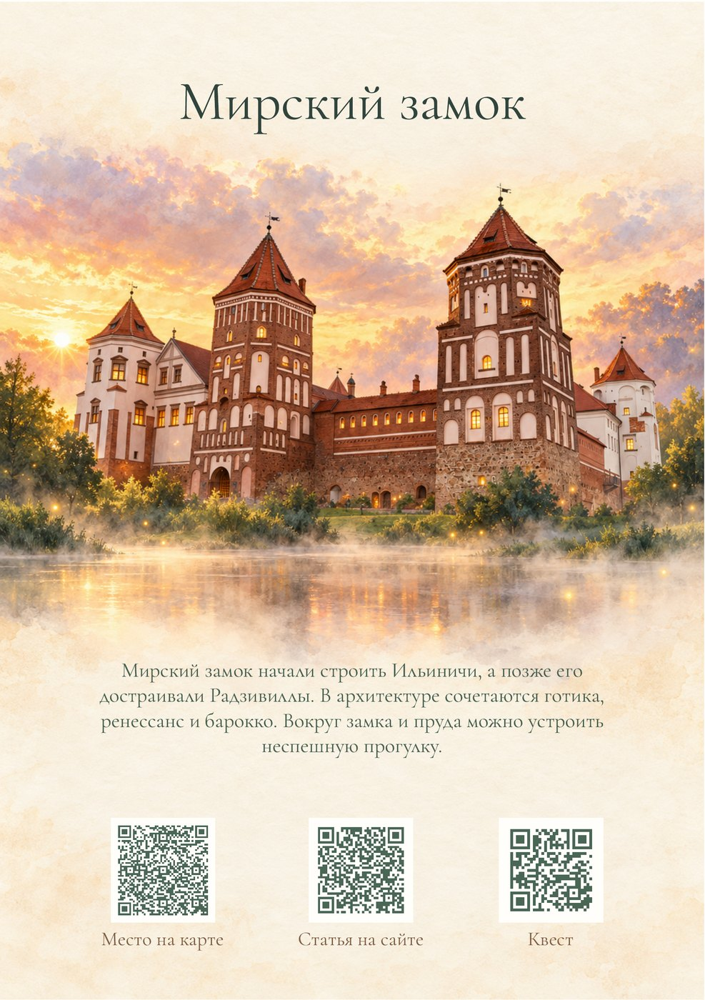
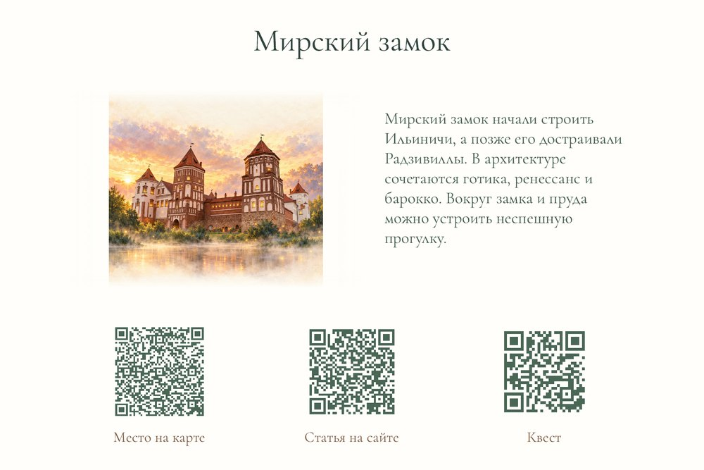
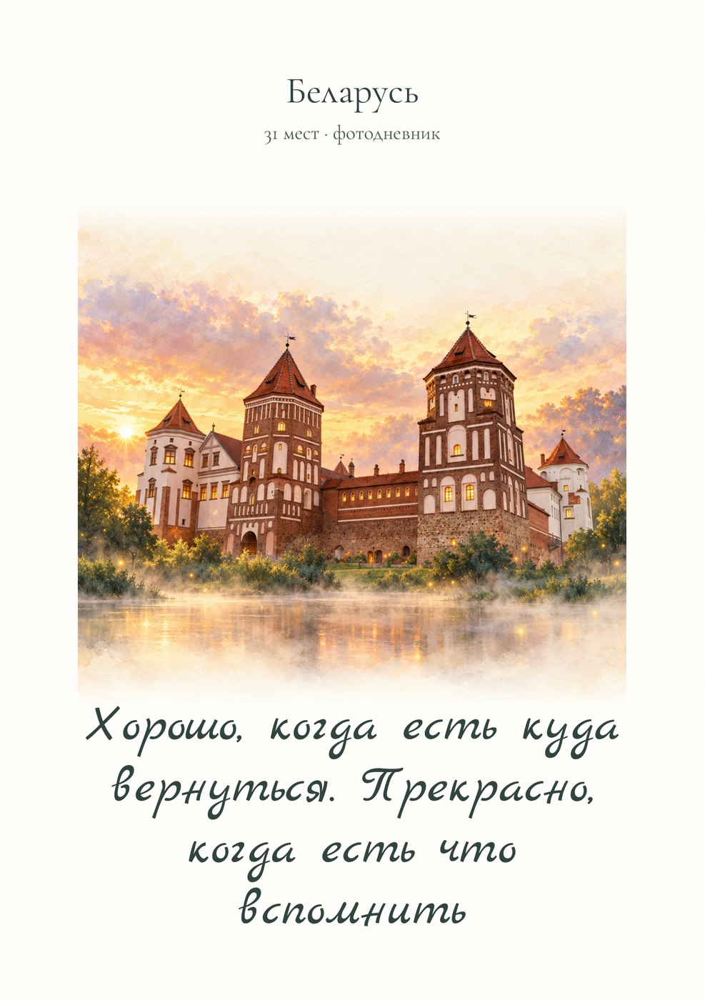

# Фэнтези: сохранённый образец и входы серии #2856

Владелец поручил «доделывай» 01.11.2026 после финальной версии Мирского замка.
Последующая команда сохранена отдельно в
[`approval.json`](../../../data/travelBooks/styles/fantasy/approval.json),
со ссылкой на точное поле и SHA журнала предыдущей сессии. Исторический
`sample/provenance.json` и его SHA не переписывались.

Место: Мирский замок, `point-5247`, опубликованная
[статья 201 автора 1](https://metravel.by/travels/nesvizh-i-mir-rasstoianie-i-marshrut-na-dva-dnia).
Источник — точный снимок этой статьи, 1000×662 px, SHA-256
`03ddc105802698b2ad7f136cf4a292b2bc9b923ca8e7355ff87874e1a001b9c9`.
Фэнтези-иллюстрация сохраняет силуэт и башни реального объекта; золотой свет
и живописная атмосфера — художественная переработка, не документальное фото.

Сохранённые уменьшенные изображения получены из проверенных PNG прежнего
PDF-образца. Полные PDF и их SHA, исходные PNG и геометрия связаны в
[`inputs.json`](../../../data/travelBooks/styles/fantasy/inputs.json).

| Страница | Изображение |
| --- | --- |
| Мирский замок, A5 148×210 мм | [Образец A5](assets/fantasy-style-sample-a5-mir.jpg) |
| Мирский замок, 150×100 мм | [Карманный образец](assets/fantasy-style-sample-pocket-mir.jpg) |
| Передняя сторона обложки, A5 | [Обложка](assets/fantasy-style-sample-a5-cover.jpg) |

Гарнитура направления — Cormorant Garamond, SIL OFL 1.1; эпиграф —
существующий Marck Script и утверждённый пресет обложки. Старый образец
использовал variable font; для полной серии подготовлен статический Regular
`wght=400`. Его 168 необходимых символов проверены по фактическому TTF,
включая RU/BE/UK/PL/EN и весь текущий текст выбранных мест. Полные локальные PDF
подтвердили встраивание Cormorant Garamond Regular как CID TrueType и вместимость.
Фэнтези-A5 дополнительно растворяет иллюстрацию в бумаге перед рассказом,
сохраняя читаемость даже у сцены с листвой в нижней части; пиксели иллюстрации
и сам рассказ не меняются.

Геометрия, поля переплёта, рассказы, QR и роли страниц наследуют
[`нормативный дизайн`](../travel-memory-books-v1.md). Образец состоит из
страницы места и четырёх сторон обложки для каждого формата; это не полный
фотодневник. Свободные фото/дневник-страницы полной книги остаются чистыми.

Вся серия из 61 иллюстрации готова и связана с BY31/PL30 через
[`входы сборки`](../../../data/travelBooks/styles/fantasy/README.md).
При полном A5 нативные изображения имеют около 180 ppi; увеличения пикселей
не было, `printReady=false`. Локальная полная сборка BY31/108 страниц и PL30/104
страниц выполнена в обоих размерах; 26 цифровых отчётов и 244 проверки QR
color/grayscale прошли. Подготовлены preview из тех же reading PDF и
[неизменяемый снимок локально активированных шести редакций](../../../data/travelBooks/releases/b356fc6cad239e0073732ce3c1bbd672c54d0edd3f2153181ac5e72c8a32df0f.json).
Четыре прежние книги сохранены без изменения их объектов/ресурсов. Серверная
публикация и приёмка сайта выполняются общим release-процессом отдельно.
