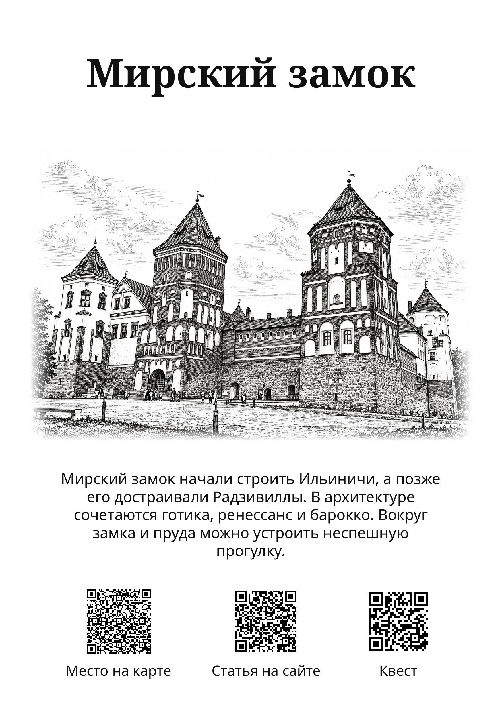

# Графика: образец для решения владельца #2855

Статус: **ожидает визуального согласования**, `approved=false`.
Подготовлена ровно одна страница места A5 148×210 мм; серия 61 иллюстрации,
обложки и полные книги не создавались.

- [PDF одной страницы](assets/graphic-style-sample-a5.pdf)
- [Превью](assets/graphic-style-sample-a5.png)
- [Происхождение, геометрия и результаты проверок](assets/graphic-style-sample-provenance.json)

Мирский замок, `point-5247`, [статья 201 автора 1](https://metravel.by/travels/nesvizh-i-mir-rasstoianie-i-marshrut-na-dva-dnia).
Использована историческая производная `mir-graphic.png` от того же точного
авторского снимка, что у акварели, фотографического и фэнтези-образцов:
SHA-256 `03ddc105802698b2ad7f136cf4a292b2bc9b923ca8e7355ff87874e1a001b9c9`.
Здание, башни и ракурс сопоставлены с оригиналом. Новый вызов imagegen не
понадобился. Полный исторический промпт и источник перенесены в durable
provenance; неизвестный идентификатор модели не придуман.

Предлагаемая типографика: Noto Serif Bold для заголовка, Noto Sans Regular
для рассказа и подписей, SIL OFL 1.1. Оба статических TTF реально встроены
в PDF как CID TrueType с Unicode. Страница собирается общим ready-book
renderer; положение заголовка, рассказа и QR соответствует текущему A5.
Чёрно-белая палитра и размещение исходной графики применены только в локальном
образце. Растровое изображение не ретушировалось: плавные края создаёт
композиция бумажной страницы.

Иллюстрация 1536×1024 px размещена в 130×86,67 мм: 300,1 ppi без увеличения.
Размеры страницы и отсутствие overflow проверены. Все три настоящих QR
(карта, исходная статья и подтверждённый квест Мирского замка) прочитаны из
растрированного PDF в цвете и градациях серого. Сам PDF визуально просмотрен.

Решение владельца требуется по графике и паре шрифтов. После согласования
направление сохраняется отдельно как approval; исторический pending-образец
не переписывается. Печатная готовность всей серии, обложки и приём типографией
этим одним образцом не подтверждаются.
